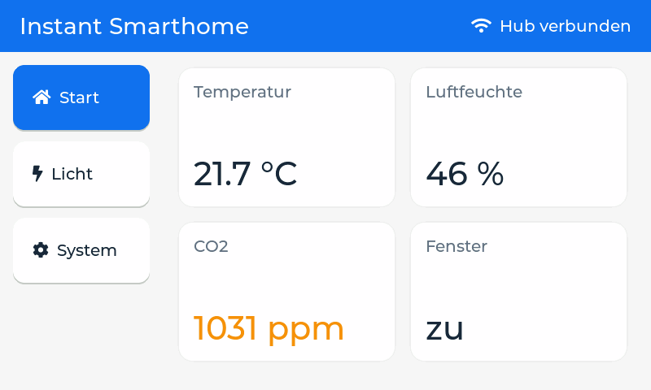

# Bedieneinheit – Instant Smarthome

Oberfläche (LVGL 9) für das **Elecrow CrowPanel 7.0" ESP32 HMI** (800 × 480).
Derselbe UI-Code läuft **am PC als Simulator** und später **auf dem Panel**.



## Ordnerstruktur

```
bedieneinheit/
├── platformio.ini        zwei Umgebungen: simulator und crowpanel
├── include/lv_conf.h     LVGL-Einstellungen (Schriften, Speicher, SDL)
└── src/
    ├── app/              läuft ÜBERALL gleich – hier arbeitest du hauptsächlich
    │   ├── ui.c / ui.h   alle Screens und Widgets
    │   ├── model.h       Daten, die angezeigt werden (Temperatur, CO2, Licht, ...)
    │   └── hal.h         Funktionen, die die Hardware-Schicht bereitstellen muss
    ├── sim/main.c        Hardware-Schicht PC: SDL-Fenster, Fake-Sensoren
    └── esp32/            Hardware-Schicht Panel: LovyanGFX, Touch, (später) Sensoren + Hub
```

Die Regel: **In `src/app/` steht nie etwas Hardware-Spezifisches.** Braucht die UI etwas von der Hardware
(Licht schalten, Helligkeit setzen), kommt eine Funktion in `hal.h`, die es in `sim/` und `esp32/` je einmal gibt.

---

## Schritt 1: Werkzeuge installieren

1. **VS Code** installieren.
2. In VS Code die Erweiterung **PlatformIO IDE** installieren (links "Extensions", nach "PlatformIO" suchen).
3. **SDL2 + Compiler** für den Simulator:

   **Windows**
   1. [MSYS2](https://www.msys2.org/) installieren.
   2. Das Programm "MSYS2 UCRT64" öffnen und eingeben:
      ```
      pacman -S mingw-w64-ucrt-x86_64-gcc mingw-w64-ucrt-x86_64-SDL2
      ```
   3. `C:\msys64\ucrt64\bin` zur Windows-Umgebungsvariable `Path` hinzufügen.
   4. VS Code neu starten. Test im Terminal: `gcc --version` muss eine Version ausgeben.

   **macOS**
   1. Terminal öffnen und die Apple-Entwicklerwerkzeuge (Compiler) installieren:
      ```
      xcode-select --install
      ```
   2. [Homebrew](https://brew.sh) installieren (den Befehl von der Startseite ins Terminal kopieren).
   3. SDL2 installieren:
      ```
      brew install sdl2
      ```
   Mehr ist nicht nötig, das Projekt findet SDL2 selbst. Test im Terminal: `clang --version` gibt eine Version aus.

   **Linux**: `sudo apt install build-essential libsdl2-dev`

## Schritt 2: Simulator starten

1. In VS Code den Ordner `bedieneinheit` öffnen (File → Open Folder). PlatformIO erkennt das Projekt automatisch.
2. Im Terminal:
   ```
   pio run -e simulator -t exec
   ```
   Beim ersten Mal lädt PlatformIO LVGL herunter, das dauert kurz. Dann öffnet sich ein 800 × 480-Fenster.

**Steuerung im Simulator**

| PC | entspricht am Gerät |
|---|---|
| Maus klicken | Touch |
| Mausrad drehen | Drehregler drehen (Fokus springt weiter) |
| Mittlere Maustaste | Drehregler drücken (OK) |
| Tab | nächstes Element |
| Pfeil links/rechts | Wert ändern, wenn ein Slider fokussiert ist |
| Enter | OK |

Im Terminal siehst du, was an den Hub geschickt würde, z. B. `[Hub] Licht an, Helligkeit 70 %`.

## Schritt 3: Die Oberfläche verändern

Fang in `src/app/ui.c` an. Gute erste Übungen:

1. **Neue Kachel**: In `build_start_page()` eine fünfte Kachel "CO" anlegen. Dafür in `model.h` ein Feld `co_ppm` ergänzen,
   in `ui_update()` den Wert setzen und in `sim/main.c` bei den Fake-Sensoren einen Wert erzeugen.
2. **Warnung**: Wenn CO2 über 1500 ppm steigt, ein Popup "Bitte lüften" zeigen (`lv_msgbox_create`). Das ist schon Ziel O2.
3. **Neue Seite**: z. B. "Heizung" mit einem Slider für die Solltemperatur des Thermostats.

Nach jeder Änderung einfach wieder `pio run -e simulator -t exec`.

Hilfreich: die [LVGL-9.2-Doku](https://docs.lvgl.io/9.2/), vor allem die Kapitel "Widgets" und
"Input devices" (dort steht, wie Gruppen und Drehregler funktionieren).

**Umlaute**: Die eingebauten Schriften können kein ä, ö, ü, ß. Deshalb heißt die Startseite momentan "Start" statt "Übersicht".
Mit dem [LVGL Font Converter](https://lvgl.io/tools/fontconverter) erzeugst du eine eigene Schrift mit Umlauten (Bereich `0x20-0x7F,0xB0,0xC4,0xD6,0xDC,0xDF,0xE4,0xF6,0xFC`).

**Grafischer Editor (optional)**: Mit [EEZ Studio](https://www.envox.eu/studio/studio-introduction/) oder SquareLine Studio
kannst du Screens per Drag-and-Drop bauen. Achte darauf, dass der Export für **LVGL 9.2** ist, und lege den erzeugten
Code nach `src/app/`.

## Schritt 4: Auf das Panel flashen (wenn es da ist)

1. Panel per USB-C anschließen.
2. ```
   pio run -e crowpanel -t upload
   pio device monitor
   ```
3. Solange die Tasten-Platine noch fehlt, kannst du im seriellen Monitor tippen:
   `w`/`s` = Fokus zurück/vor, `a`/`d` = Wert ändern, `e` = OK.

Die Einstellungen in `platformio.ini` für das Panel: ESP32-S3 mit 4 MB Flash und 8 MB PSRAM (OPI).
Ohne PSRAM bleibt das Display schwarz.

**Hardware-Version**: Das Panel gibt es als V2.0 und V3.0. V3.0 setzt den Touch-Chip über einen PCA9557 zurück.
Die Firmware erkennt das selbst (`touch_reset_v3()` in `src/esp32/main.cpp`).

> Die Panel-Firmware ist noch nicht auf echter Hardware getestet. Falls das Bild verschoben ist oder flackert,
> zuerst `freq_write` in `src/esp32/LGFX_CrowPanel7.h` auf `12000000` senken.

## Wie es weitergeht

- [ ] Umlaut-Schrift erzeugen und einbinden
- [ ] Alle Screens im Simulator fertig bauen (Start, Licht, Heizung, Fenster, System)
- [ ] Mit Jonathan das Nachrichtenformat zum Hub festlegen (z. B. ESP-NOW mit einem `struct`)
- [ ] Mit Nikola klären, wie Tasten/Drehregler und Sensoren angeschlossen werden (I2C oder UART)
- [ ] `hal_send_light()` usw. in `src/esp32/` durch echte Funk-Kommunikation ersetzen
- [ ] Fake-Sensoren durch echte Sensoren ersetzen
